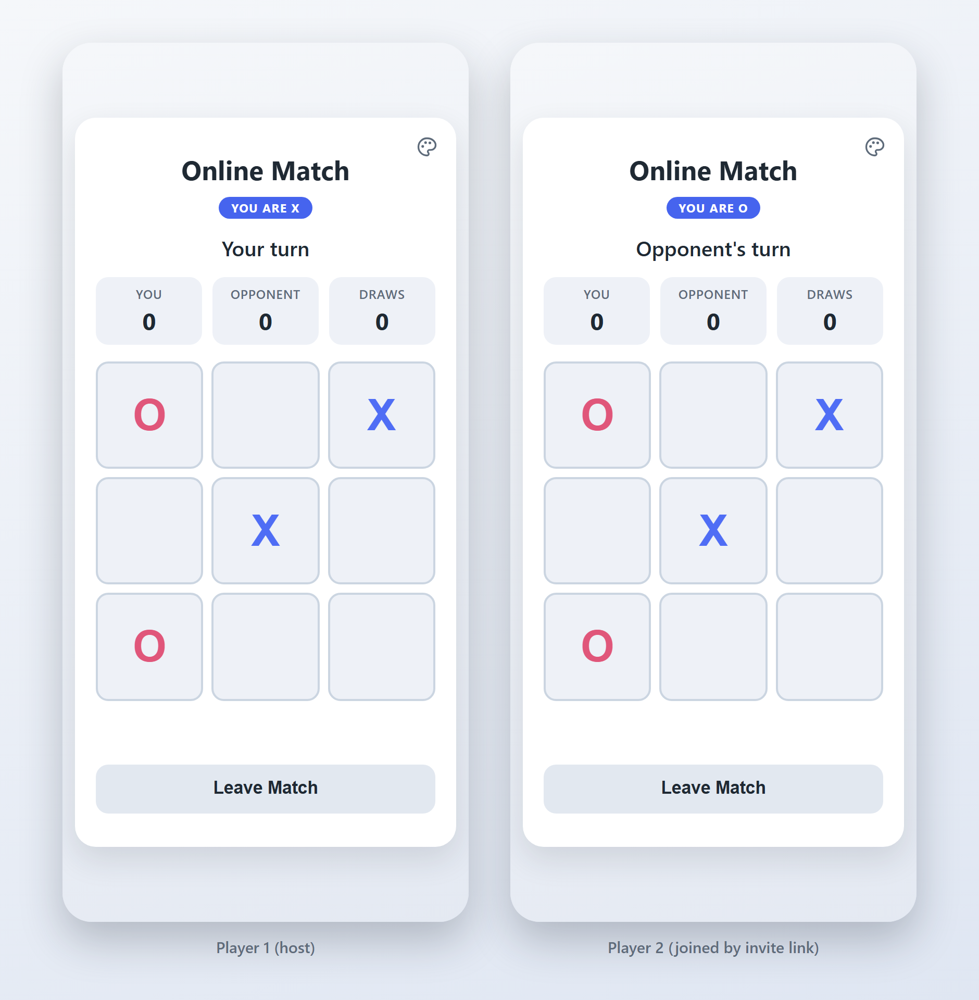
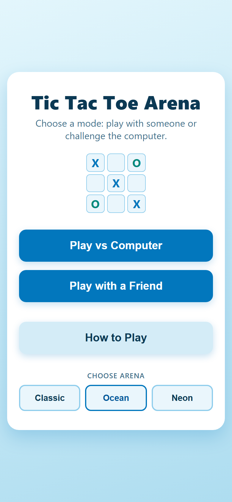
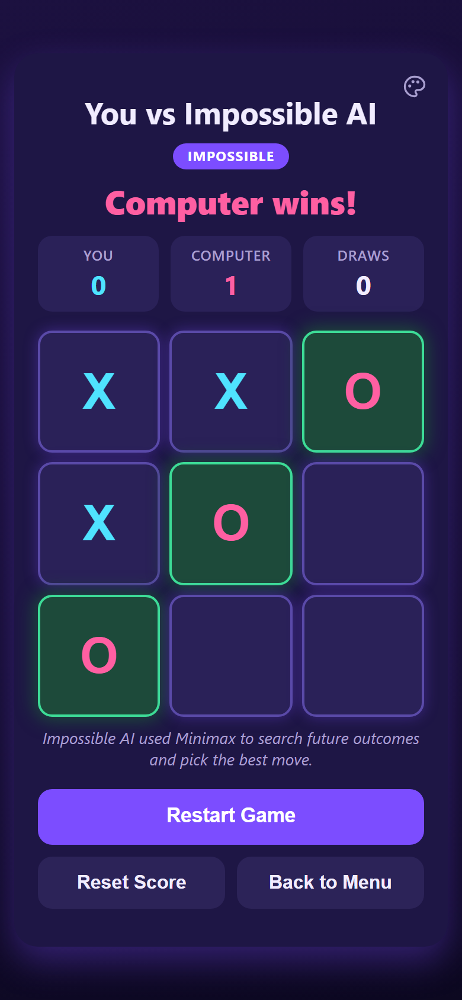

# Tic Tac Toe Arena

A browser-based Tic Tac Toe game with three computer opponents, from random to an unbeatable Minimax AI, plus real-time online play with a friend through an invite link.

**Live demo:** https://tic-tac-toe-arena-theta.vercel.app

## What It Does

- **Same Device:** two players take turns on one screen.
- **Play vs Computer:**
  - **Easy:** random moves.
  - **Medium:** a mix of sensible and random moves.
  - **Impossible:** Minimax search. It cannot be beaten.
- **Online:** create a room, share the invite link or 6-character room code, and play live on two devices.
  - Includes rematches and a running score.
  - No sign-up is required.
- **Arenas:** Classic, Ocean and Neon themes. You can switch from the home screen or during a game without affecting the match.
- **Responsive and accessible:**
  - Works from small phones up to desktop.
  - Keyboard support and screen reader announcements.
  - Respects reduced-motion settings.

## Highlights

**Game AI**
- **Recursive Minimax** for the Impossible level, with depth-aware scoring.
- **Exhaustive test proving Impossible never loses:** it plays every possible sequence of human moves against the AI.

**Online play**
- **Server-authoritative moves:** every move is a PostgreSQL function call (RPC) that validates the player, turn, square and result. Browsers cannot write game rows directly.
- **Invisible anonymous authentication:** each browser gets an anonymous Supabase identity, with no account screens.
- **Row Level Security:** each player can read only the rooms they are in.
- **Realtime sync:** row updates reach both players, and version numbers discard stale or duplicate updates.
- **Disconnect awareness (Presence):** shows when the opponent disconnects or comes back, with a short grace period so a quick refresh isn't reported as a disconnect.
- **Refresh and rejoin recovery:** reloading the page or reopening the invite link returns the player to the same seat and game state.
- **Rematches swap marks:** players take turns going first, and scores are tracked per person rather than per mark.
- **Scheduled clean-up:** an hourly database job removes rooms that have been idle for more than 24 hours.

## How the AI Works

The human is always X and moves first; the computer is O.

| Level | Strategy |
|---|---|
| Easy | Picks a random empty square. |
| Medium | About 65% of turns play "smart", the other 35% are random. |
| Impossible | Full recursive Minimax search of every remaining game. |

**Medium's "smart" priority:** win → block → center → free corner → random free square.

**Impossible:**
- Scores each finished position: win +10, loss −10, draw 0, adjusted by depth so it prefers faster wins and slower losses.
- The computer maximizes the score; it assumes the human minimizes it.
- When two moves score the same, it always takes the first in board order, so its play is deterministic.

**Exhaustive validation:** the test suite plays every legal sequence of human moves against Impossible:

| Result | Count |
|---|---|
| Complete games | 569 |
| AI wins | 386 |
| Draws | 183 |
| Human wins | **0** |
| Illegal moves | **0** |

## Online Multiplayer Architecture

```
Browser ── Supabase Anonymous Auth ──> an anonymous player ID, no visible sign-in
   │
   ├── RPC calls ──> PostgreSQL SECURITY DEFINER functions
   │                 create_game · join_game · make_move · request_rematch · leave_game
   │
   ├── Realtime ───> row updates for the room (moves, joins, rematches)
   │
   └── Presence ───> who is currently connected (display only)
```

**Who decides what**
- **The database row is the single source of truth:** board, marks, turn, scores, rematch requests and who left.
- **Clients cannot modify game rows:** Row Level Security only lets players read their own rooms, and all writes are revoked. The only way to change a game is through the five RPCs.
- **The server validates every action:**
  - Each RPC checks the caller's seat, whose turn it is, that the square is legal and empty, and that the room is open and not expired.
  - It then computes the win, draw or score itself.
  - It locks the row while doing so, so simultaneous moves or joins cannot both succeed.
- **Presence never decides the game:** it is only used to show whether the opponent is connected (e.g. "Opponent disconnected").

**How clients stay in sync**
- **Version numbers prevent stale updates:** every change increments the row's `version`, and the client ignores anything not newer than what it already shows. Each move is therefore drawn and announced exactly once, even if it arrives both as an RPC reply and as a Realtime event.
- **Rooms open automatically:** the game screen opens on both devices as soon as the row shows both players.
- **Recovery reads the row again:** after a reconnect or when the tab becomes visible again, the client re-fetches the row before allowing moves.

The database schema, policies and functions are in [`supabase/migrations/`](supabase/migrations/).

## Testing

**`npm test`: 129 passing tests** (Node.js built-in test runner):
- **Game rules:** wins, draws and legal moves.
- **AI behaviour** in every position the computer can face, including the exhaustive Impossible test above.
- **Online client logic:**
  - room codes and invite links
  - version ordering
  - turn, score and rematch state from each player's side
  - automatic match entry
  - connection and Presence transitions
  - friendly error messages, so raw technical errors never reach the player

**Database tests** in [`supabase/tests/`](supabase/tests/) (written for pgTAP):
- constraints, privileges and Row Level Security
- all five RPCs, scoring, rematches, expiry, leaving, and the scheduled clean-up
- a generator that checks the SQL winner logic against the JavaScript logic on all 19,683 possible boards

These tests have been run in PGlite (Postgres compiled to WebAssembly) with a small stand-in for pgTAP, not yet with `supabase test db`. See [`TEST_PLAN.md`](supabase/tests/TEST_PLAN.md).

**Additional verification during development** (these scripts are not part of the repository):
- **Against the hosted backend:**
  - simultaneous moves and simultaneous joins: exactly one succeeds each time
  - full online games, rematches, refreshes, disconnects and reconnects
- **In automated browsers:**
  - layout checks at 360×640, 390×664, 390×844 and 1280×800 in all three themes
  - confirmation that the local and AI modes make zero requests to Supabase (the online library is only loaded when online play starts)

## Tech Stack

- HTML, CSS and plain JavaScript, with no framework and no build step.
- Node.js built-in test runner (`node --test`).
- Supabase: Anonymous Auth, PostgreSQL with Row Level Security, Realtime and Presence, and pg_cron for the clean-up job.
- `supabase-js`, loaded from a CDN only when online play starts.
- Hosted on Vercel as a static site.

## Run Locally

No install or build step is needed.

**Local and AI modes:** open `index.html` directly in a browser.

**Online mode and invite links:** serve the folder over HTTP, for example:

```bash
python -m http.server 8000
# then open http://localhost:8000
```

A `localhost` invite link normally only works on the same computer (for example in two browser windows). To play across real devices, use the [live demo](https://tic-tac-toe-arena-theta.vercel.app).

Online play from a local copy connects to the project's Supabase backend. `src/online-config.js` contains only the Supabase project URL and its publishable key. These values are designed to be public; access is enforced by Row Level Security and the database functions. No secret keys are stored in this repository.

**Tests** (requires Node.js 20 or newer; there are no dependencies to install):

```bash
npm test
```

## Project Structure

```
index.html              page and screens
styles.css              layout and the three themes
script.js               screens, themes, local game flow and the board
src/
  game.js               game rules (pure functions)
  ai.js                 Easy, Medium and Impossible (Minimax)
  online.js             online game logic (pure functions: state, views, messages)
  online-client.js      Supabase connection (loaded on demand)
  online-ui.js          lobby, invites and the online match
  online-config.js      public Supabase URL and publishable key
supabase/
  migrations/           schema, RLS, RPCs, Realtime and the scheduled clean-up
  tests/                database tests and test plan
tests/                  Node tests (npm test)
python-prototype/       the original Pygame version of the game
```

`python-prototype/` is the earlier desktop version written with Pygame, where the project started. It is kept for reference and is separate from the web app.

## Screenshots

All three are captured from the live site.

**Online match:** two browser sessions in the same room, each with its own anonymous identity.



| Home screen (Ocean) | Impossible AI (Neon) |
|---|---|
|  |  |
